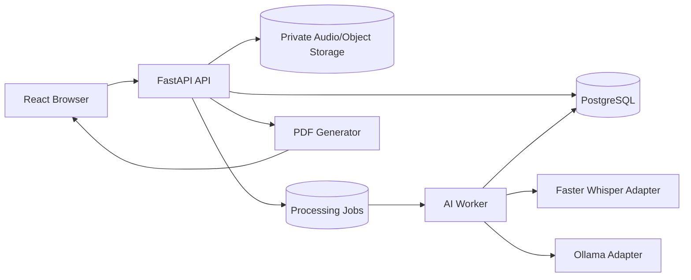
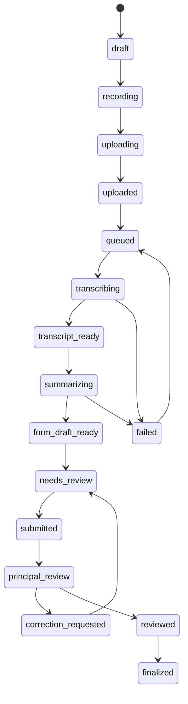

# Architecture

## Trust boundaries

Browser is untrusted. Every record, file, export and workflow transition is authorized server-side.

Audio storage is private. Browser access is mediated through authenticated API endpoints.

Transcript content is untrusted input to the summarizer. It must never be treated as system instructions.

## Processing lifecycle

## Vertical slice today

The backend now contains the core domain model and APIs for the first end-to-end workflow. The frontend is intentionally not implemented in this backend pass.
